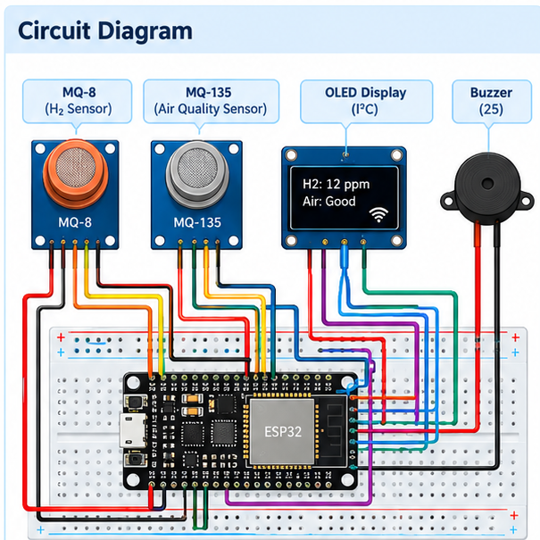

# H₂ Leak Detector

## Aim

To detect the presence of hydrogen gas and monitor changes in air quality, with readings transmitted wirelessly over Wi-Fi.

## What is the project?

A gas-monitoring system that uses gas sensors and an ESP32 microcontroller to detect changes in gas concentration and send readings to a connected device.

## How does it work?

1. The MQ-8 sensor responds to hydrogen gas, while the MQ-135 responds to certain other gases and changes in air quality.
2. The sensors produce electrical signals that vary with the gases they detect.
3. The ESP32 reads and processes the sensor signals according to its program.
4. Using its built-in Wi-Fi, the ESP32 can send readings to a compatible device or dashboard.
5. The connected device displays readings or an alert if that feature is programmed.

## Components used

- ESP32 microcontroller
- MQ-8 hydrogen gas sensor
- MQ-135 air-quality sensor
- OLED display
- Buzzer
- Breadboard
- Jumper wires
- Wi-Fi-connected device for monitoring

## Circuit Diagram

## Connections

| Component / Pin | Typical connection |
|---|---|
| MQ-8 VCC | Breadboard positive |
| MQ-8 GND | Breadboard negative |
| MQ-8 output | Pin 34 (ESP32) |
| MQ-135 VCC | Breadboard positive |
| MQ-135 GND | Breadboard negative |
| MQ-135 output | Pin 35 (ESP32) |
| ESP32 5V | Breadboard positive |
| ESP32 GND | Breadboard negative |
| Buzzer positive | Pin 25 (ESP32) |
| OLED VCC | Breadboard positive |
| OLED GND | Breadboard negative |
| OLED SCL/SCK | Pin 22 (ESP32) |
| OLED SDA | Pin 21 (ESP32) |

## Important wiring notes

- The source document does not specify the OLED's VCC and GND connections or the buzzer's negative connection. Check the labels and requirements of your actual modules before wiring them.
- MQ sensor modules are commonly powered at 5V. Their analogue output voltage must be kept within the ESP32's permitted input range. Check your exact module and use an appropriate voltage divider or level shifter if needed before connecting the output to GPIO 34 or GPIO 35.
- Connect all modules to a common ground.
- The diagram is an illustrative reference. Verify the actual module pin labels and your circuit before powering it.

## Note

This is an educational prototype, not a certified hydrogen leak detector or a substitute for proper gas-detection and safety equipment. Do not rely on it for real-world leak detection or safety decisions.
